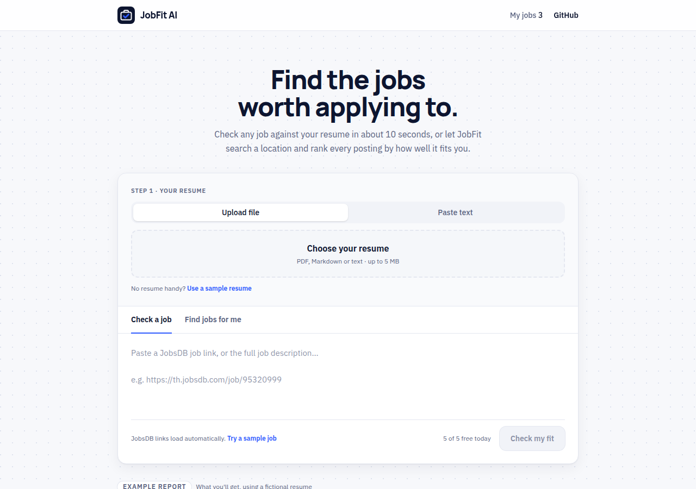
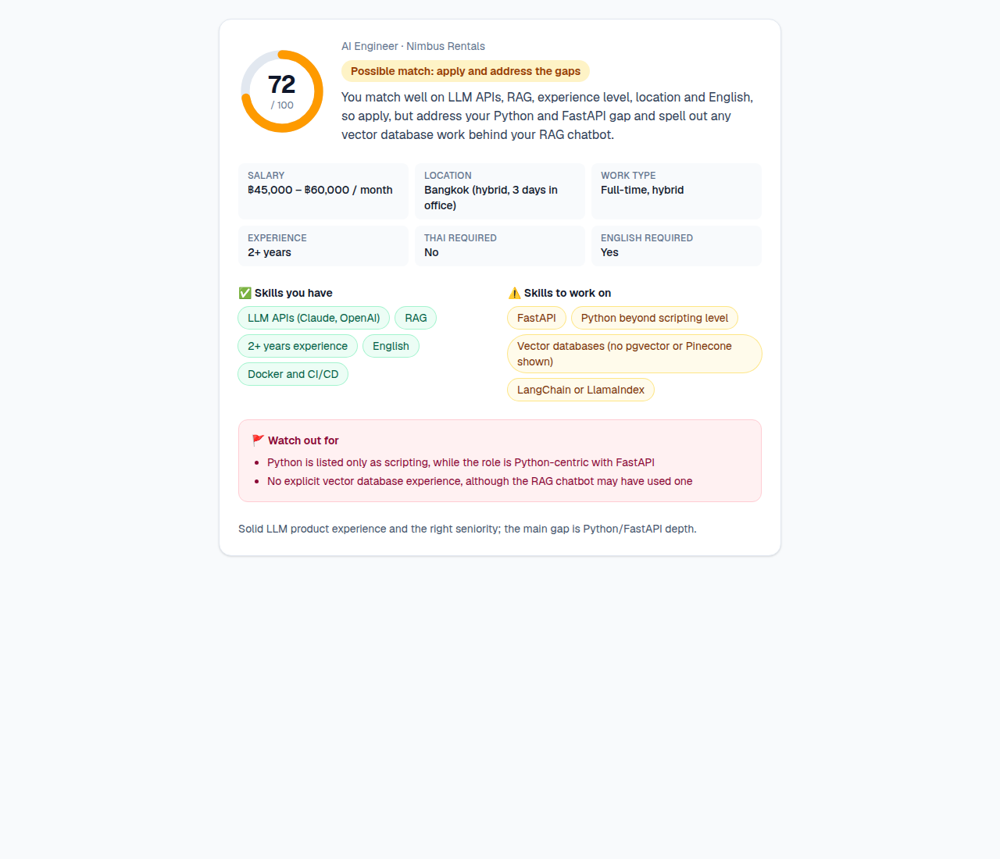
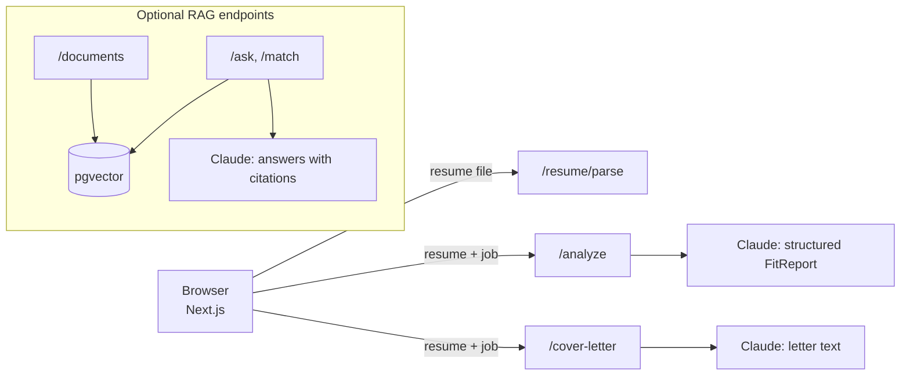

# JobFit AI

**Paste a job posting. In about 10 seconds, see if it fits your resume, what you're missing, and get a tailored cover letter.**

I built this during my own job search. Checking each posting against my resume, spotting deal-breakers like "Thai language required" or "7+ years", and writing a cover letter took 20–30 minutes per job. JobFit AI does the first pass in seconds, so I can spend my time on the jobs that are worth it.



## How it works

1. **Add your resume** once: upload a PDF or paste the text. It stays in your browser and is never stored on the server.
2. **Paste a JobsDB job link**, or the job description from any other site. JobsDB links are read automatically.
3. **Get your fit report:**
   - a **fit score** (0–100) and a clear verdict: *apply*, *apply and address the gaps*, or *probably skip*
   - the **key facts**: salary, location, work type, years required, and whether Thai or English is required
   - **skills you have** and **skills to work on**
   - **red flags** such as language, location or seniority mismatches
4. **Write a cover letter** tailored to the job with one click, then edit and copy it.



## Tech stack

| Layer | Technology |
|---|---|
| Front end | Next.js 16, React 19, TypeScript, Tailwind CSS |
| API | Python 3.12, FastAPI, Pydantic |
| AI | Claude (Anthropic API) with structured outputs and citations |
| RAG | LangChain, PostgreSQL + pgvector (Supabase), FastEmbed local embeddings |
| Quality | pytest (45 tests), evaluation suite, GitHub Actions CI |



**Design choices**
- **One call per analysis.** `/analyze` returns the job facts, match and verdict in a single Claude call using a Pydantic schema, which is faster and cheaper than chaining calls.
- **Privacy by default.** The web app never stores resumes: `/resume/parse` only returns the text, and the browser keeps it.
- **Grounded output.** Prompts tell Claude to use only what the resume and posting say and never to invent skills. The RAG endpoints return citations to the exact source text.
- **Paste a link, not a wall of text.** `/job/fetch` reads one JobsDB job page on request and returns its text for the user to check before analysing. To stay safe it only accepts JobsDB job links, rebuilds the URL from the job ID, refuses redirects that leave JobsDB, and caps time and size. It reads a single public page per request and never crawls. If JobsDB changes its page layout, pasting the text still works.
- **Safe to put online.** Daily per-visitor and global limits, input size limits, and a switch to turn off the database endpoints keep a public demo from running up the API bill.
- **Testable by design.** The LLM, vector store and limiter are FastAPI dependencies, so tests swap in fakes and run without a database or API key.

## Run it locally

You need Python 3.12, Node.js 20+, and an [Anthropic API key](https://console.anthropic.com/).

**1. API**
```bash
python3 -m venv .venv
source .venv/bin/activate
pip install -r requirements-dev.txt
cp .env.example .env          # add your ANTHROPIC_API_KEY
uvicorn app.main:app --reload # http://localhost:8000/docs
```

**2. Web app** (in a second terminal)
```bash
cd web
cp .env.example .env.local
npm install
npm run dev                   # http://localhost:3000
```

Open http://localhost:3000, click **Use a sample resume** and **Try a sample job**, then **Check my fit**.

The fit check and cover letter don't need a database. The optional RAG endpoints (`/documents`, `/ask`, `/match`) need PostgreSQL with pgvector: run `docker compose up -d`, or create a Supabase project, enable the `vector` extension, and set `DATABASE_URL` to its Session pooler connection string (starting with `postgresql+psycopg://`).

## API

| Endpoint | Purpose |
|---|---|
| `POST /resume/parse` | PDF/Markdown/text file → resume text (nothing stored) |
| `POST /job/fetch` | JobsDB job link → job title, company, location, salary and full description as text |
| `POST /analyze` | Resume + job posting → `FitReport`: job facts, fit score, skills, red flags, verdict |
| `POST /cover-letter` | Resume + job posting (+ name) → tailored cover letter |
| `GET /usage` | Today's usage and remaining analyses for this visitor |
| `POST /documents`, `/documents/text` | Chunk, embed and store a document in pgvector |
| `POST /ask` | Question → retrieved chunks → answer **with citations** |
| `POST /extract` | Job posting → structured `JobPosting` JSON |
| `POST /match` | Job posting → fit against stored resumes (RAG) |

Interactive docs: http://localhost:8000/docs

## Evaluation

`evals/run_eval.py` measures quality on the fictional sample data in `data/`:
- **RAG answers:** 10 questions graded by required keywords, including two the documents *can't* answer, to check the model says so instead of guessing.
- **Extraction:** 3 job postings, checking salary, years of experience and Thai-language fields.

```bash
python -m evals.run_eval --ingest   # first run loads data/ into the store
python -m evals.run_eval            # later runs
```

**Latest results** (Oct 2026):

| Check | Claude Sonnet 5.5 | Claude Haiku 5.5 |
|---|---|---|
| RAG answers (10 questions, incl. 2 the documents can't answer) | **10/10** | **10/10** |
| Structured extraction (3 job postings) | **3/3** | **3/3** |
| Fit verdicts on the 3 sample jobs | possible / weak / possible | same |
| Cost per fit analysis | ~$0.013 | **~$0.001** |

**Choosing the model.** Haiku matched Sonnet on every check above, gave the same verdicts, caught the same deal-breakers (Thai required, relocation, seniority) and wrote equally accurate cover letters at about a twelfth of the cost, so it's the default. Sonnet was slightly more thorough in flagging red flags; switch with `CLAUDE_MODEL=claude-sonnet-5-5`.

The first run was useful: it showed the job postings had never been ingested (the model correctly said "the documents only contain a resume" instead of guessing), and it exposed two weak spots in the keyword grader, which were fixed before this run.

## Tests

```bash
pytest -q                      # API: 45 tests, no database, API key or network needed
cd web && npm run lint && npm run build
```

GitHub Actions runs both on every push.

## Deploying a public demo

**API on Render** (or any Python host):
- Build command: `pip install -r requirements.txt`
- Start command: `uvicorn app.main:app --host 0.0.0.0 --port $PORT`
- Environment variables:

| Variable | Value |
|---|---|
| `ANTHROPIC_API_KEY` | your key |
| `ALLOWED_ORIGINS` | your web app URL, e.g. `https://jobfit-ai.vercel.app` |
| `DAILY_LIMIT_PER_VISITOR` | `5` |
| `DAILY_LIMIT_TOTAL` | `100` |
| `DAILY_FETCH_LIMIT_PER_VISITOR` | `30` |
| `ENABLE_RAG_ENDPOINTS` | `false` |
| `PYTHON_VERSION` | `3.12.3` |

**Web app on Vercel:** import the repo, set the **Root Directory** to `web`, and set `NEXT_PUBLIC_API_URL` to the API URL.

Also set a monthly spending limit in the Anthropic Console as a final safety net.

## Configuration

| Variable | Default | Purpose |
|---|---|---|
| `ANTHROPIC_API_KEY` | (required) | Claude API key |
| `CLAUDE_MODEL` | `claude-haiku-5-5` | Model used for all calls (`claude-sonnet-5-5` for a little more thoroughness at ~12x the cost) |
| `ALLOWED_ORIGINS` | `http://localhost:3000` | Comma-separated web origins allowed to call the API |
| `DAILY_LIMIT_PER_VISITOR` | `0` (unlimited) | Claude-backed requests per visitor per day |
| `DAILY_LIMIT_TOTAL` | `0` (unlimited) | Claude-backed requests per day across all visitors |
| `DAILY_FETCH_LIMIT_PER_VISITOR` | `0` (unlimited) | JobsDB links read per visitor per day |
| `ENABLE_RAG_ENDPOINTS` | `true` | Set `false` on a public demo |
| `DATABASE_URL` | local Docker Postgres | Only needed for the RAG endpoints |
| `EMBEDDING_MODEL` | `BAAI/bge-small-en-v1.5` | Local embedding model for RAG |

## Project structure

```
app/            FastAPI backend
  main.py         routes, error handling, usage limits
  llm.py          Claude calls: fit report, cover letter, cited answers, extraction
  limits.py       daily per-visitor and global limits
  store.py        LangChain PGVectorStore + FastEmbed embeddings
  ingest.py       PDF/Markdown text extraction and chunking
  schemas.py      Pydantic models for requests, responses and structured outputs
web/            Next.js + Tailwind front end
evals/          evaluation cases and runner
data/           fictional sample resume and job postings
tests/          API and ingestion tests
```

## Roadmap

- Save analysed jobs and ask questions across them (using the existing RAG endpoints)
- Hybrid search (keyword + vector)
- LLM-graded evaluation alongside keyword checks
