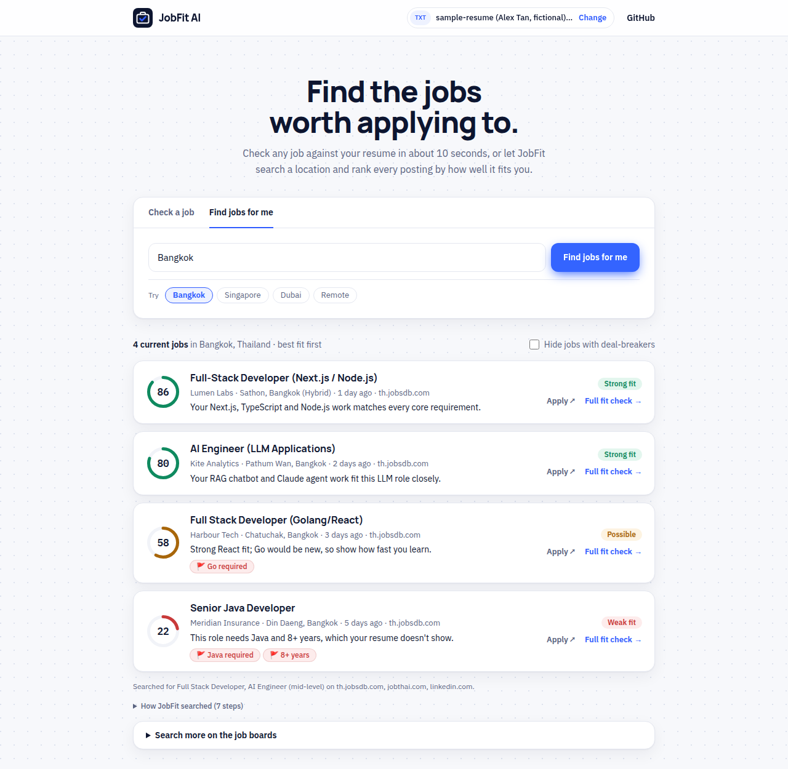
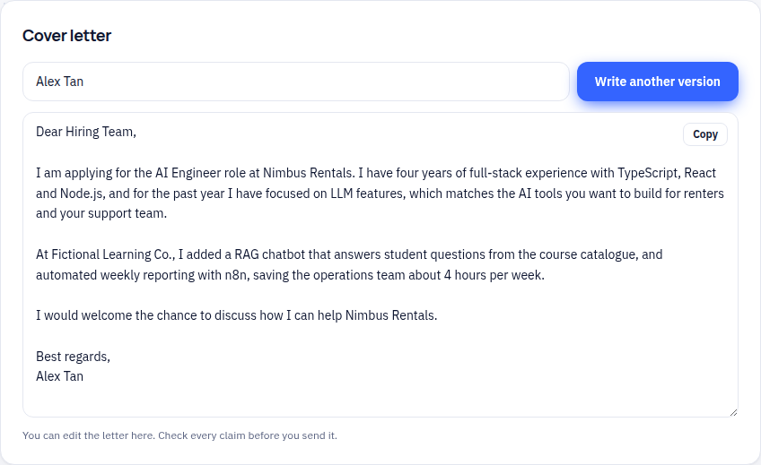
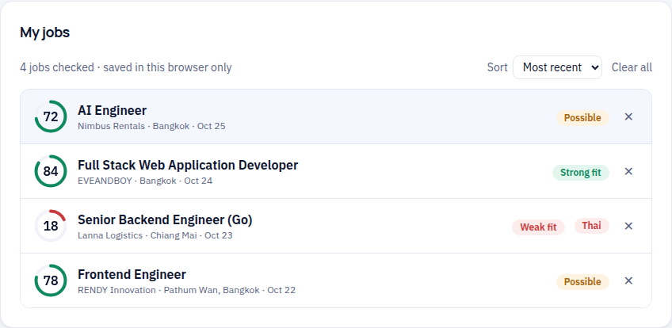
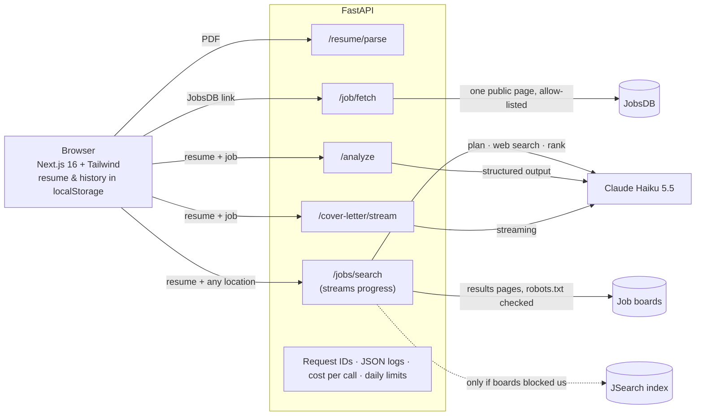

# JobFit AI

**Upload your resume. Find current jobs that fit you, ranked by fit, or paste any job to see how well it fits, what you're missing, any deal-breakers, and get a tailored cover letter.**

**Live demo:** _coming soon_ · Built with Next.js, FastAPI, Claude and LangChain


---

## The problem

During my own job search in Bangkok I applied to 30+ roles in two weeks. For every posting I did the same manual work: read it, compare it with my resume, look for deal-breakers ("fluent Thai required", "7+ years", "on-site in Chiang Mai"), decide whether to apply, then write a cover letter. That took 20–30 minutes per job, and most of the time went into postings that were never a fit.

## The solution

JobFit AI does that first pass in seconds:

1. **Add your resume once.** Upload a PDF or paste text. It stays in your browser.
2. **Find jobs or paste one.** *Find jobs for me* takes **any location** (a city, a country or "Remote"), finds current postings on that location's own job boards, and ranks them against your resume while you watch its progress. Or paste any job: a JobsDB link is read automatically.
3. **Get a fit report:** a 0–100 score and a clear verdict (*apply*, *apply and address the gaps*, *probably skip*), the key facts (salary, location, years, whether Thai is required), the skills you have and the ones you're missing, and red flags.
4. **Get a cover letter** that streams in as it's written, based only on what your resume actually says.
5. **Track it.** Every analysed job is saved to *My jobs*, sortable by fit, so you can compare postings and reopen them later.

| Find jobs for me | Fit report | Cover letter | My jobs |
|---|---|---|---|
|  |  |  |  |

## Architecture



The API also keeps the original **RAG endpoints** (`/documents`, `/ask`, `/match`) built on LangChain, PostgreSQL + pgvector and local FastEmbed embeddings, which answer questions about stored resumes and postings **with citations** to the exact source text. They're switched off on the public demo.

## Key decisions and trade-offs

**1. One structured Claude call per analysis.** `/analyze` returns the job facts, the match and the verdict in a single call validated against a Pydantic schema (`messages.parse`). Chaining an extraction call and a matching call would double latency and cost for no quality gain.

**2. Haiku instead of Sonnet, chosen by measurement.** I ran the same evaluation and the same three sample jobs on both models:

| | Claude Sonnet 5.5 | Claude Haiku 5.5 |
|---|---|---|
| RAG answers (10 questions, incl. 2 the documents can't answer) | 10/10 | **10/10** |
| Structured extraction (3 postings) | 3/3 | **3/3** |
| Verdicts on the 3 sample jobs | possible / weak / possible | **same** |
| Cost per fit analysis | ~$0.013 | **~$0.001** |

Haiku matched Sonnet on every check, caught the same deal-breakers and wrote equally accurate letters at about a twelfth of the cost. Sonnet was slightly more thorough with red flags, so it's one environment variable away (`CLAUDE_MODEL`).

**3. Streaming the cover letter, and lowering effort.** The letter streams word by word. Measuring time to first word showed the model was spending ~900 tokens reasoning before writing; a cover letter is writing, not reasoning, so I lowered the effort setting for that call:

| Effort | First words | Full letter | Output tokens |
|---|---|---|---|
| medium | 4.9 s | 5.8 s | 1,422 |
| **low** | **1.4 s** | **2.3 s** | **302** |

Same letter quality, 3.5× faster to first word, about 80% fewer tokens.

**4. Privacy by default.** Resumes and saved jobs live in the browser's localStorage. `/resume/parse` returns text without storing anything, and the server keeps no user data.

**5. Reading job links safely.** `/job/fetch` turns a pasted JobsDB link into text, which removes the most tedious step. Because a server that fetches user-supplied URLs can be abused, it only accepts JobsDB job links, rebuilds the URL from the job ID, refuses any redirect that leaves JobsDB, and caps time (10 s) and size (3 MB). It reads one public page per request and never crawls. If JobsDB changes its layout, pasting the text still works.

**6. Safe to put online.** Per-visitor and global daily limits on every Claude-backed endpoint, a separate limit for link fetching, input size limits, and a monthly spending cap in the Anthropic Console mean a public demo can't run up the bill.

**7. Free hosting without a frozen first visit.** Render's free plan sleeps after 15 idle minutes, and waking takes 30–60 s. A scheduled GitHub Action pings `/health` every 10 minutes to keep the API awake, and the web app calls the API the moment the page opens. If it's still asleep, a small banner explains that the server is starting (the visitor can add their resume meanwhile) instead of the app looking broken.

**8. Smart job search for any location, built on what the web actually allows.** I tested four approaches before settling on this one:

| Approach | Result |
|---|---|
| Job APIs only (JSearch, Jooble) | Good for Singapore and Dubai, **zero Thailand coverage**, fixed country list |
| Claude web search alone | Mostly listing pages and stale cached postings |
| Claude web search + web fetch (Sonnet) | Found real Bangkok jobs, but 93 s and $0.66 per search, and still couldn't confirm them |
| **Claude plans and discovers, our code reads, Claude ranks** | **Bangkok: 30 current jobs in ~15 s, 5/5 runs** |

How it works:
1. **Plan** (Claude Haiku): from the resume and any location, choose job titles and that location's main job boards (JobsDB and JobThai for Thailand, StepStone for Germany, Seek for Australia…).
2. **Discover** (Claude web search): find those boards' own results pages (a page listing many current jobs).
3. **Read** (plain code, no AI): open up to 3 results pages, **only if the site's robots.txt allows it**, and cut each into job cards (title, company, location, date, summary). Individual job pages are never crawled; JobsDB's robots.txt disallows them, and results pages already carry what's needed to rank.
4. **Fill in** (JSearch): many big boards block automated readers (Jobstreet, Seek, StepStone, LinkedIn), so if the boards gave fewer than 15 jobs, the same titles are searched in Google's job index. Bangkok never needs it; Singapore and Berlin do.
5. **Rank** (Claude Haiku, parallel batches): clean up and score every card, drop postings older than 60 days.

Progress streams to the browser as it happens. Measured: **Bangkok 30 jobs in ~15 s; Singapore 20 in 34 s; Berlin 20 in 44 s**, at roughly **$0.05–0.10 per search** (mostly web searches).

Things I fixed along the way: ranking 19 jobs first took 97 s, because the time went into output tokens, so I score in parallel batches of 3 (~4 s). Claude sometimes miscopied the APIs' long job IDs and a job silently vanished, so it now gets short numbers that code maps back. Vague cards scored too generously, so scores are capped at 65 when the card doesn't show requirements. And when Anthropic's search tool refused a site (xing.com), the whole search failed, so it now drops that site and retries.

**9. Grounded, honest output.** Prompts tell Claude to use only what the resume and posting say and never to invent skills, numbers or employers. The fit report lists missing skills rather than glossing over them.

## Quality

| | |
|---|---|
| **API tests** | 70 pytest tests: endpoints, limits, streaming, robots.txt rules (checked against JobsDB's real file), card extraction for two page layouts, the search pipeline's decisions, and URL-safety rules (including redirects to private addresses). No database, API key or network needed. |
| **Browser tests** | 18 Playwright tests run the whole flow on a desktop and a phone-sized screen against a mocked API: smart job search with live progress, fit check, streamed cover letter, saved jobs surviving a reload, JobsDB links, error messages, a sleeping server, no sideways scrolling. |
| **LLM evaluation** | `evals/run_eval.py`: 10 RAG questions (two of which the documents can't answer, to catch guessing) and 3 extraction checks. The first run caught missing test data and two grading bugs; current score 13/13. |
| **CI** | GitHub Actions runs pytest, lint, type checks, the production build and the Playwright suite on every push. |
| **Observability** | Every request gets an `X-Request-ID`. Logs are JSON, and every Claude call logs model, tokens, latency and estimated cost. |

A Claude call in the logs (cover letter at low effort):

```json
{"event": "claude_call", "request_id": "e0202c5f110a", "operation": "cover_letter_stream",
 "model": "claude-haiku-5-5", "input_tokens": 1049, "output_tokens": 302,
 "latency_ms": 2310, "est_cost_usd": 0.000256}
```

## Tech stack

| Layer | Technology |
|---|---|
| Front end | Next.js 16 (App Router), React 19, TypeScript, Tailwind CSS 4 |
| API | Python 3.12, FastAPI, Pydantic, httpx |
| AI | Claude via the Anthropic SDK: structured outputs, streaming, citations |
| RAG | LangChain, PostgreSQL + pgvector (Supabase), FastEmbed |
| Testing | pytest, Playwright, custom LLM evaluation |
| Deployment | Vercel (web), Render (API), GitHub Actions |

## Run it locally

You need Python 3.12, Node.js 20+, and an [Anthropic API key](https://console.anthropic.com/).

```bash
# API
python3 -m venv .venv && source .venv/bin/activate
pip install -r requirements-dev.txt
cp .env.example .env              # add your ANTHROPIC_API_KEY
uvicorn app.main:app --reload     # http://localhost:8000/docs

# Web app (second terminal)
cd web
cp .env.example .env.local
npm install
npm run dev                       # http://localhost:3000
```

Click **Use a sample resume** and **Try a sample job**, then **Check my fit**.

The optional RAG endpoints need PostgreSQL with pgvector: `docker compose up -d`, or a Supabase project with the `vector` extension and `DATABASE_URL` set to its Session pooler connection string (starting with `postgresql+psycopg://`).

### Tests

```bash
pytest -q                          # API
cd web && npm run lint && npm run test:e2e   # builds the app, then runs the browser tests
python -m evals.run_eval           # LLM evaluation (calls Claude, costs about $0.01)
```

## Deploying

**API on Render:** Dashboard → **New → Blueprint** → select this repo. `render.yaml` sets the demo limits; you'll be asked for `ANTHROPIC_API_KEY` and `ALLOWED_ORIGINS` (the web app's URL).

**Web app on Vercel:** import the repo, set **Root Directory** to `web`, and add `NEXT_PUBLIC_API_URL` (the Render URL) and `NEXT_PUBLIC_SITE_URL` (the Vercel URL).

Then set a monthly spending limit in the Anthropic Console, and add a repository **variable** `API_URL` (GitHub → Settings → Secrets and variables → Actions → Variables) set to the Render URL so the keep-alive workflow can ping it.

## API reference

| Endpoint | Purpose |
|---|---|
| `POST /resume/parse` | PDF/Markdown/text → resume text (nothing stored) |
| `POST /jobs/search` | Resume + any location → streamed progress, then current postings ranked by fit (NDJSON) |
| `POST /job/fetch` | JobsDB link → title, company, location, salary and full description |
| `POST /analyze` | Resume + job → `FitReport`: job facts, fit score, skills, red flags, verdict |
| `POST /cover-letter/stream` | Resume + job (+ name) → cover letter, streamed as plain text |
| `POST /cover-letter` | Same, as a single JSON response |
| `GET /usage` | Today's usage and remaining analyses for this visitor |
| `POST /documents`, `/documents/text` | Chunk, embed and store a document in pgvector |
| `POST /ask` | Question → retrieved chunks → answer with citations |
| `POST /extract` | Job posting → structured `JobPosting` JSON |
| `POST /match` | Job posting → fit against stored resumes (RAG) |

Interactive docs at `/docs` on the running API.

## Configuration

| Variable | Default | Purpose |
|---|---|---|
| `ANTHROPIC_API_KEY` | (required) | Claude API key |
| `CLAUDE_MODEL` | `claude-haiku-5-5` | Model for all calls |
| `ALLOWED_ORIGINS` | `http://localhost:3000` | Web origins allowed to call the API (comma-separated) |
| `DAILY_LIMIT_PER_VISITOR` | `0` (unlimited) | Claude-backed requests per visitor per day |
| `DAILY_LIMIT_TOTAL` | `0` (unlimited) | Claude-backed requests per day across all visitors |
| `DAILY_FETCH_LIMIT_PER_VISITOR` | `0` (unlimited) | JobsDB links read per visitor per day |
| `DAILY_SEARCH_LIMIT_PER_VISITOR` / `DAILY_SEARCH_LIMIT_TOTAL` | `0` (unlimited) | Smart searches per visitor / overall per day |
| `JSEARCH_API_KEY` | (optional) | [OpenWeb Ninja JSearch](https://www.openwebninja.com/api/jsearch) key, used when a location's job boards block automated reading |
| `ENABLE_RAG_ENDPOINTS` | `true` | Set `false` on a public demo |
| `DATABASE_URL` | local Docker Postgres | Only for the RAG endpoints |

## Project structure

```
app/              FastAPI backend
  main.py           routes, error handling, usage limits
  llm.py            Claude calls: fit report, streamed cover letter, cited answers, extraction
  jobfetch.py       safe JobsDB link reader
  smartsearch.py    the job search pipeline: plan, discover, read, fill in, rank
  webfetch.py       polite fetcher: robots.txt (wildcard-aware), public-HTTPS-only, limits
  cards.py          turns a results page into job cards, no AI needed
  jsearch.py        Google for Jobs index (fallback source)
  observability.py  request IDs, JSON logs, cost per Claude call
  limits.py         daily per-visitor and global limits
  store.py, ingest.py   LangChain pgvector store, PDF/Markdown chunking
web/              Next.js front end (app/, components/, lib/, e2e/ Playwright tests)
evals/            LLM evaluation cases and runner
tests/            pytest suite
data/             fictional sample resume and job postings
```

## What I'd build next

- Accounts and a synced job tracker (applied / interview / offer) across devices
- Read more job boards that render with JavaScript (headless browser), where robots.txt allows
- More job sites behind the same safe-fetch rules
- An LLM-graded evaluation set built from real, anonymised postings
- Persistent rate limits (Redis) for multi-instance deployments
